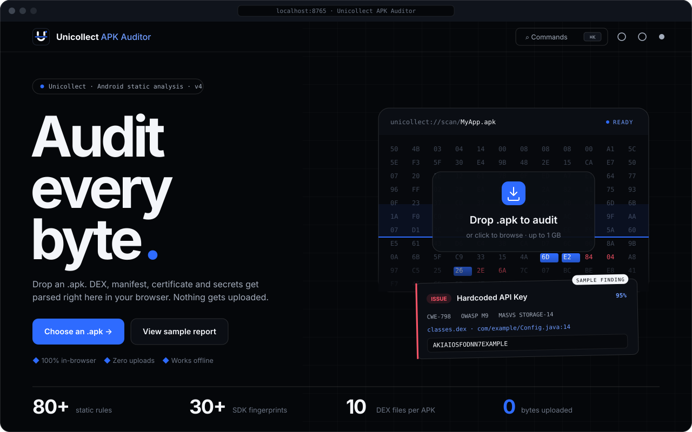
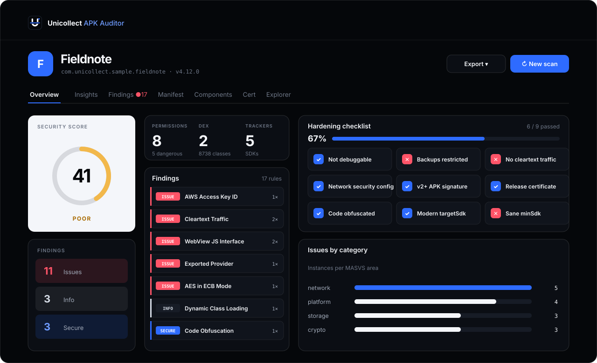

<p align="center">
  
</p>

<p align="center">
  <b>🛡️ Android APK static security analysis. 100% in your browser. Nothing leaves the tab.</b>
</p>

<p align="center">
  
  
  
  
  
</p>

<p align="center">
  
</p>

---

## ⚡ What it is

Drop an `.apk` on the page. **Unicollect APK Auditor** parses the DEX bytecode, decodes the binary `AndroidManifest.xml`, reads the signing certificate, walks every component, hunts for secrets, and hands you a security score, a hardening checklist and exportable reports. All of it runs client-side inside a Web Worker.

<p align="center">
  <picture>
    <source media="(prefers-color-scheme: light)" srcset="docs/assets/landing-light.svg">
    
  </picture>
</p>

## 🆕 Version 1.0.0 · "Scan Bay"

| | Feature | What you get |
|---|---|---|
| 🎨 | **Brand-new UI** | X-ray scanner look: graphite tunnel / light table, signal orange, false-colour byte wall (orange code, blue signing, green resources). |
| 🌗 | **Theme transition** | Dark ↔ light now scales out of the toggle as a circular reveal (View Transitions), with a colour cross-fade fallback. |
| ✨ | **New motion system** | Every in / out animation is fade, scale or colour only. Nothing slides on x or y. Overlays, menus, toasts and findings now animate *out* too. |
| ⏳ | **Real site loader** | Boot screen tracks every stylesheet, font and script the page actually loads, with live percent and real byte counts. |
| 📦 | **Live byte counter** | The landing stat used to be a static "0 bytes uploaded". It now shows real bytes scanned locally (uploads stay at 0 B), and the scan overlay shows bytes read in real time. |
| 👤 | **Creator watermark** | "Created by muvixo" in the app and in every export. |

## 🆕 What's new in v4

| | Feature | What you get |
|---|---|---|
| 🎨 | **Full new UI** | Black, white and one electric blue. Sora + Inter + JetBrains Mono, self-hosted. Live "byte scanner" drop zone. Dark and light themes. |
| 📊 | **Insights tab** | Hardening checklist (12 checks), issues by MASVS area, OWASP Mobile Top 10 heatmap, hot files, file fingerprints (MD5 / SHA-1 / SHA-256 / SHA-512). |
| 🔀 | **Baseline diff** | Load a JSON report from an older build and see **new**, **resolved** and **still open** issues plus the score change. Re-scans of the same package are diffed automatically. |
| 🕘 | **Scan history** | The last 12 scans (metadata only) on the start page. Toggle it off any time. |
| 🧪 | **Sample report** | One click to explore the full UI with a synthetic app. Also via `?sample=1`. |
| ⌨️ | **Command palette** | `Ctrl/⌘ + K` for every action: tabs, exports, theme, settings, baseline. |
| ⚙️ | **Settings drawer** | Theme, density, findings per page, mask secrets for screen shares, auto-expand issues, reduce motion. |
| 📝 | **More exports** | Self-contained **HTML report** and **Markdown** report, plus one-click **Copy summary**. |
| 📋 | **Small wins** | Copy manifest XML, app name fallback when no manifest, tracker list fix, installable web-app manifest, print styles. |

<p align="center">
  
</p>

## 🔬 What it actually parses

- 🧬 **DEX** · header, string pool, type IDs, method IDs, class defs and bytecode. Up to 10 DEX files (`classes.dex` … `classes10.dex`).
- 📜 **AXML** · binary AndroidManifest decoded back to readable XML.
- 🔏 **PKCS#7** · signing certificate subject, issuer, algorithm, validity, fingerprint.
- ✍️ **APK Signing Block** · v2 / v3 detection in the trailing bytes (Janus check).
- 📦 **resources.arsc** · compiled string resources scanned for secrets.
- 📡 **Trackers** · DEX strings matched against 30+ SDK fingerprints (Firebase, AdMob, Facebook, Crashlytics, Branch …).
- 🧠 **Rule engine** · 80+ static rules across crypto, network, manifest, WebView, storage and code. Every finding carries CWE, OWASP Mobile Top 10 and MASVS tags.
- 🔑 **Entropy-aware secrets** · Shannon entropy gates vendor regexes for AWS, Stripe, Google, GitHub, Slack, Twilio, JWT, PEM and more.

## 🗂️ Tabs

| Tab | Shortcut | Inside |
|---|---|---|
| 🏠 Overview | `Alt + 1` | Score, findings split, app metadata, dangerous permissions, trackers, URLs |
| 📊 Insights | `Alt + 2` | Hardening checklist, MASVS bars, OWASP heatmap, hot files, fingerprints, baseline diff |
| 🚨 Findings | `Alt + 3` | Severity filter, search (`/`), confidence slider, sort, expand all, copy match |
| 📜 Manifest | `Alt + 4` | Package & SDK, permission table, raw decoded XML (copyable) |
| 🧩 Components | `Alt + 5` | Activities, services, receivers, providers, exported flags, intent filters, ready-made `adb` commands |
| 🔏 Cert | `Alt + 6` | Subject, issuer, algorithm, validity, fingerprint, v1 / v2 status |
| 🗃️ Explorer | `Alt + 7` | File tree, quick access, name / content / DEX-string search, hex viewer, download |

## 🚀 Run it

No build step. No `npm install`. Plain JavaScript.

```bash
# any static server works
python3 -m http.server 8765
# then open http://localhost:8765/
```

Want the demo straight away? Open `http://localhost:8765/?sample=1`.

> 💡 Opening `index.html` directly from disk works too, but some browsers block Web Workers on `file://`. The app then falls back to the main thread automatically.

## 📤 Export formats

| Format | Use it for |
|---|---|
| 📄 **PDF** | Printable audit with cover, summary, every finding, certificate, components, trackers |
| 🌐 **HTML** | One self-contained file you can email or attach to a ticket |
| 📝 **Markdown** | Pull requests, wikis, issue trackers |
| 🧾 **JSON** | The full result tree. Also the input for **Baseline diff** |
| 📊 **CSV** | Flat findings table for spreadsheets |
| 🐙 **SARIF 2.1** | GitHub Code Scanning |

## ⌨️ Keyboard

| Key | Action |
|---|---|
| `Ctrl / ⌘ + K` | Command palette |
| `Alt + 1 … 7` | Jump to tab |
| `← →` | Move between tabs |
| `/` | Focus findings search |
| `N` | New scan |
| `T` | Toggle theme |
| `?` | Shortcut list |
| `Esc` | Close menus, collapse findings |

## 🏗️ Architecture

```
index.html               App shell, landing page, overlays
manifest.webmanifest     Installable web-app metadata
fonts/                   Sora, Inter, JetBrains Mono (woff2, self-hosted)
icons/                   Logo + app icons (SVG)
docs/assets/             README artwork (SVG)
src/
  styles.css             v1.0.0 "Scan Bay" design system (tokens, motion, components)
  main.js                UI coordinator: tabs, rendering, drag & drop, explorer
  extras.js              insights, diff, history, palette, settings, byte counter
  sample.js              Synthetic sample report
  analyzer.worker.js     Web Worker entry point
  core/
    engine.js            AXML, DEX, PKCS#7, rules, trackers, scoring
    entropy.js           Shannon entropy + vendor secret patterns
    export.js            JSON / CSV / SARIF 2.1
    report.js            Markdown / HTML / summary + hardening checks
    pdf.js               PDF audit report
lib/
  jszip.min.js
  jspdf.umd.min.js
```

## 🔒 Privacy

The APK is read with the File API, transferred to a Web Worker, parsed in memory and dropped when you close the tab. A strict Content-Security-Policy blocks network calls, and fonts are bundled locally, so the page makes **zero** third-party requests. Scan history stores only metadata (name, package, score, counts, rule IDs) in `localStorage`, and you can turn it off or wipe it from Settings.

## 📏 Limits

- Each rule emits at most 20 instances per file, capped at 500 per rule.
- Up to 5,000 DEX classes are scanned for rule patterns (the parser still reads them all).
- Resource files over 300 KB are sampled.
- Extra fingerprints (SHA-1 / SHA-512) are computed for files under 400 MB.

## 👤 Creator

**Created by muvixo.**

## 📄 License

See [LICENSE](LICENSE). Bundled fonts (Sora, Inter, JetBrains Mono) are under the SIL Open Font License 1.1, see [fonts/OFL.txt](fonts/OFL.txt).

> ⚠️ For authorized security testing and education only. Get permission before analyzing APKs you do not own.
